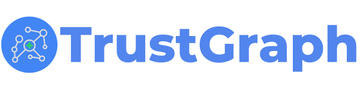

<div align="center">



[**Website**](https://trustgraph.ai) | [**Docs**](https://docs.trustgraph.ai) | [**YouTube**](https://www.youtube.com/@TrustGraphAI?sub_confirmation=1) | [**Launch TrustGraph**](https://config-ui.demo.trustgraph.ai/) | [**Discord**](https://discord.gg/sQMwkRz5GX) | [**Blog**](https://blog.trustgraph.ai/subscribe)

# The open source ontology runtime for AI agents

</div>

Every platform now sells you an ontology. [TrustGraph](https://trustgraph.ai) is the one you own.
 
For enterprises deploying AI agents where decisions carry real risk, TrustGraph is the **open-source ontology runtime** that turns your documents and data into ontology-grounded knowledge, and governs what every agent and user can see from it.
 
Unlike other platform ontologies, TrustGraph is built on W3C standards (RDF, OWL, SHACL, PROV-O) for total ownership and portability of your knowledge and business logic. Your ontology, your knowledge, and your audit trail stay yours, portable across any cloud, model or deployment.

## How it works

```
            Your ontology                       Your documents & data
                 │                                       │
                 └──────────────────┬────────────────────┘
                                    ▼
                         ┌──────────────────────┐
              1. EXTRACT │     OntologyRAG      │  Triples match classes and properties,
                         │                      │  checked against constraints
                         └──────────┬───────────┘
                                    ▼
                         ┌──────────────────────┐
              2. GROUND  │    Context Graph     │  RDF knowledge in named graphs,
                         │                      │  with PROV-O lineage to every source
                         └──────────┬───────────┘
                                    ▼
                         ┌──────────────────────┐
              3. GOVERN  │  SHACL-AF Policies   │  Every query evaluated per node:
                         │                      │  Allowed · Filtered · Violation
                         └──────────┬───────────┘
                                    ▼
                     GraphRAG · SPARQL · Agents · MCP
           + a queryable trace of how each answer was produced
```

[Additional Technical Diagrams](/diagrams/)
 
## What makes it different
 
| | TrustGraph | Platform ontologies |
|---|---|---|
| **Data model** | W3C RDF, OWL, JSON-LD | Vendor object model |
| **Where it runs** | Docker, Podman, Kubernetes, any cloud, on-prem or self-hosted models | Inside one vendor's data estate |
| **Knowledge source** | Documents (PDF, DOCX, XLSX, PPTX, HTML, Markdown, CSV), images, and structured data | Mostly warehouse tables and metadata |
| **Access control** | SHACL-AF policies evaluated on every query | Platform permissions |
| **Audit trail** | PROV-O in queryable named graphs | Platform logs |
| **Models** | All major LLM APIs, hosted or self-hosted open weight models | Platform's choice |
| **License** | Apache 2.0 | Commercial |
 
## Core capabilities
 
### 1. Own it: open standards, portable knowledge
- Knowledge is stored as RDF, including language tags, XSD datatypes and RDF-star quoted triples.
- Load knowledge as Turtle or TriG (named graphs preserved); export the graph as Turtle.
- Package knowledge into **Context Cores** that carry triples, embeddings, provenance and source documents between deployments.
- Move whole workspaces between deployments with portable `.tgx` bundles (`tg-export-workspace` / `tg-import-workspace`).
### 2. Use it: ontology to knowledge
- **OntologyRAG** uses your ontology to guide extraction. A similarity-based selector picks the relevant part of the ontology for each chunk, with a bypass mode for small ontologies.
- Extracted triples are validated against ontology **domain and range constraints, including the subclass hierarchy**. Triples that break the rules are rejected.
- `rdf:type` attributes are stored with graph embeddings, so you can filter vector searches by entity type.
- Schema-free **GraphRAG** and hybrid (BM25 + vector) **DocumentRAG** are also available, both with cross-encoder reranking.
### 3. Govern it: policy-based query filtering (new in 2.10)
- Write access policies as **SHACL-AF** shapes, stored in the `urn:graph:policy` named graph.
- Every graph query is evaluated node by node with a tri-state result: **Allowed**, **Filtered** or **Violation**.
- Policies apply across the REST API, SPARQL and GraphRAG, using a per-request user context.
- Each evaluation publishes a structured `policy.evaluation` audit event.
- With no policies loaded, the system runs in open mode.
### 4. Steer it: guided graph traversal (new in 2.10)
- Supply grounding seeds or graph seeds to skip LLM concept extraction.
- Restrict each hop by type, relationship or named graph, and filter edges by language tag.
### 5. Prove it: explainability
- Extraction emits **PROV-O** lineage from document to page, chunk and edge (`urn:graph:source`).
- GraphRAG, DocumentRAG and agent queries record full reasoning traces (`urn:graph:retrieval`).
- Inspect them with `tg-show-explain-trace` and `tg-show-extraction-provenance`, or query them with SPARQL.
### 6. Decide fast (new in 2.10)
- **Decision Scoring** (Laya, ONNX Runtime, ~35 ms per call): pick an option, score on an ordered scale, or get a yes/no confidence.
- **Cloze Classification**: auto-train a DistilBERT classifier from labeled examples and serve it with confidence scores.
## Agents and APIs
 
- **Agent orchestrator** with ReAct, Plan-then-Execute and Supervisor patterns.
- **MCP server** with tools for graph queries, SPARQL, GraphQL over structured data and embeddings, with bearer-token authentication.
- **SPARQL 1.1** query service with 30+ built-in functions and streaming results.
- REST, WebSocket, Python SDK, TypeScript libraries and a full `tg-*` CLI.


## Support & Community

- **Have Questions?** [Join our Discord](https://discord.gg/sQMwkRz5GX)
- **Found a Bug?** [Open an issue](https://github.com/trustgraph-ai/trustgraph/issues)
- **Need Help?** [Check the documentation](https://docs.trustgraph.ai)
- **Ready to Contribute?** [See the contributing guide](CONTRIBUTING.md)
